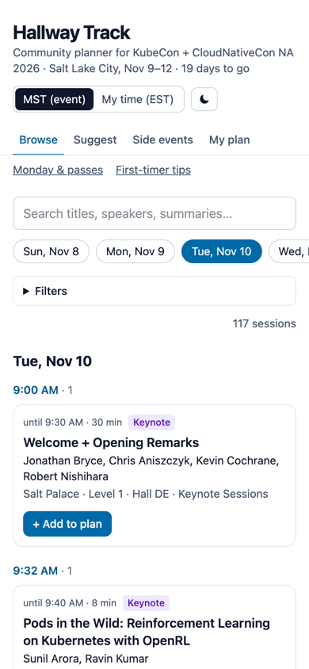
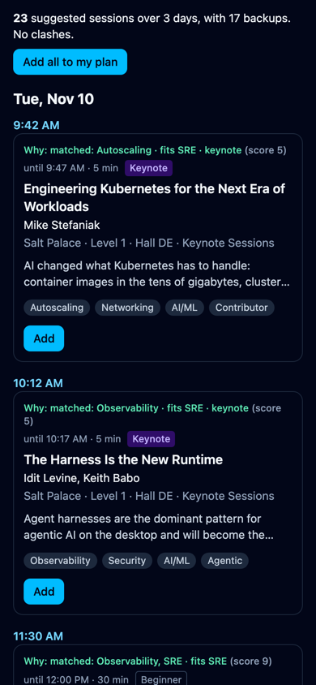
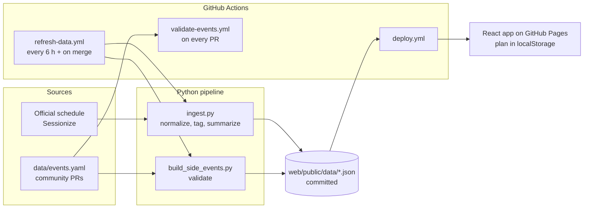

# Hallway Track

**A community planner for KubeCon + CloudNativeCon North America 2026**
Salt Lake City · Nov 9–12, 2026

**Open it: https://kirananil007.github.io/hallway-track-na26/**

> Unofficial community project. Not affiliated with or endorsed by CNCF or the Linux Foundation.

<p>
  
  &nbsp;
  
</p>

## What it does

- **Browse** all sessions by day and time, with search and filters (track, type, level, interests).
- **Plan my KubeCon:** answer five quick questions and get a clash-free plan with a backup
  per slot. Every pick says why it was chosen.
- **My plan:** overlapping sessions are flagged; mark one as a backup. **Export to your
  calendar** (Google, Apple, Outlook) or **share your plan as a link**.
- **Side events:** community meetups, happy hours and project gatherings, added through pull
  requests. They're part of conflict checks and calendar export too.
- **Monday & passes:** compare the co-located events and see which pass gets you in.
- **First-timer tips:** practical advice, written by the community.

Times show in Salt Lake City time (MST) or your own. Works on phones, in dark mode, and
without an account. **No backend, no cookies, no tracking:** your plan stays in your browser.

## How it works



- **Sessions** come from the official schedule on Sessionize, fetched politely (one request
  every 6 hours, a User-Agent naming this repo). We keep only the title, time, room, speakers
  and a ~200-character summary, and every session links to its official page. If a fetch fails
  or looks wrong, the last good data stays live.
- **Interest tags** come from keyword matching in [pipeline/tags.yaml](pipeline/tags.yaml).
  PRs that improve it are welcome.
- **The app** is a static Vite + React + TypeScript + Tailwind site. All the logic
  (filters, conflicts, scoring, calendar export, share links) is plain, unit-tested functions
  in [web/src/lib/](web/src/lib/).

### How "Plan my KubeCon" suggests sessions

No AI and no server: the same answers always give the same plan, and every pick shows why.
The rules live in [web/src/lib/scoring.ts](web/src/lib/scoring.ts) and
[web/src/lib/recommend.ts](web/src/lib/recommend.ts).

- **Score:** +3 per chosen interest the session is tagged with, +2 if its official track matches
  an interest, up to +2 for tags related to your role, +2/+1/−2 for an exact/near/far level match,
  and +1 for keynotes. A session must match at least one chosen interest.
- **Pick:** the highest-scoring sessions go in first, and anything that clashes is skipped.
- **Backup:** for each pick, the best leftover session in the same time slot. A backup can
  score higher than its main pick when it also clashes with another, better pick (long
  tutorials and Contribfests often do).
- **Pass:** without All-Access, co-located events are left out; Monday's Project Lightning
  Talks are included with any pass.

## Run it locally (about 5 minutes)

You need [Node.js](https://nodejs.org/) 22+ and [uv](https://docs.astral.sh/uv/) (it installs
Python 3.12 for you). The repo already contains the latest data, so the app runs without the pipeline.

```bash
git clone https://github.com/kirananil007/hallway-track-na26.git
cd hallway-track-na26

# Web app
cd web
npm install
npm run dev        # open http://localhost:5173/hallway-track-na26/
npm test           # unit tests
npm run lint

# Data pipeline (optional)
cd ../pipeline
uv run pytest                      # tests
uv run python ingest.py            # fetch the latest schedule into web/public/data/
uv run python build_side_events.py # validate data/events.yaml and rebuild side events
```

## Contributing

**Add a side event in about a minute, right from GitHub's web editor:** see
[CONTRIBUTING.md](CONTRIBUTING.md). Every pull request is checked automatically by
[validate-events.yml](.github/workflows/validate-events.yml), and merged events show up on
the site within minutes. You can also improve the
[first-timer tips](web/src/content/first-timer.md) or the [interest tags](pipeline/tags.yaml).

## License

[Apache-2.0](LICENSE). KubeCon and CloudNativeCon are trademarks of the Linux Foundation;
this project only uses the names to describe the event it helps with.
